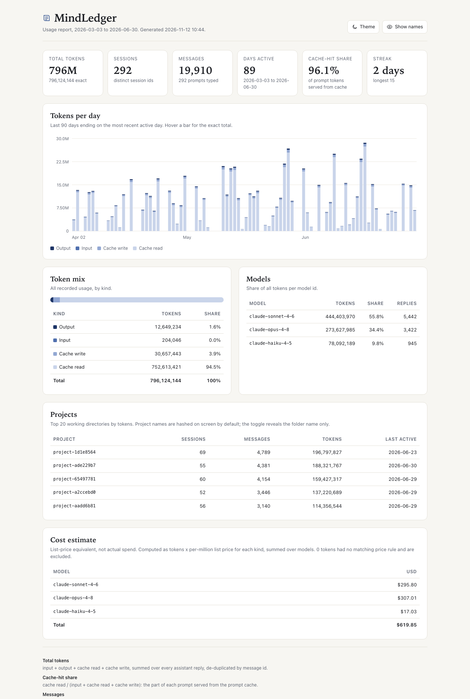
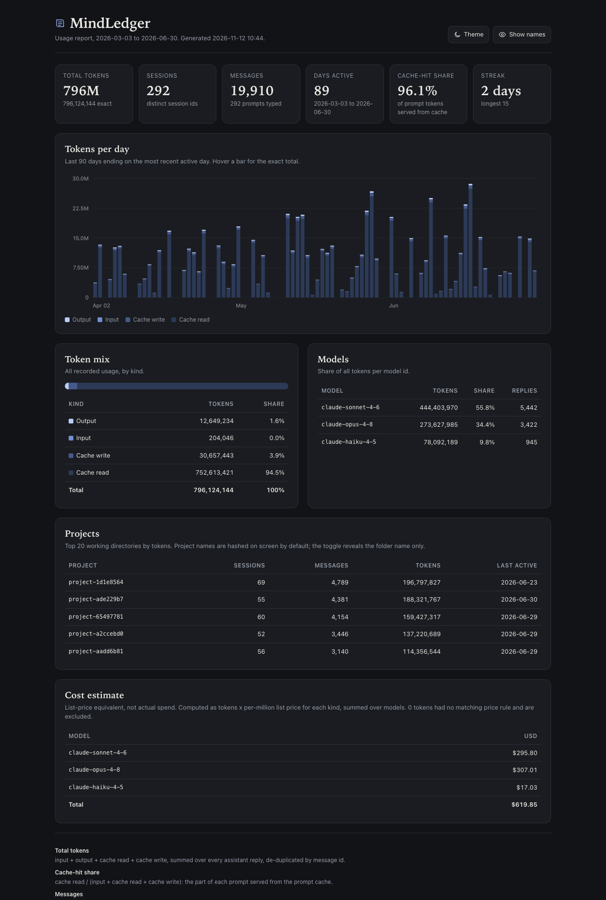

# MindLedger

A private, local ledger of your coding-agent usage for Claude Code.

MindLedger reads the session transcripts Claude Code already writes to your
disk and turns them into honest numbers: tokens per day (input, output, cache
read, cache write), sessions, messages and models. It keeps an append-only
ledger that shouts when your lifetime total ever goes backwards, backs up your
agent configuration with secrets scrubbed, renders a single self-contained HTML
report, and can export a tiny public-stats file for your website.

Python 3 standard library only. macOS and Linux. No network calls, no
telemetry, no accounts.

This is the open-source core of a system the author uses daily, tracking 300B+
tokens.



<details><summary>Dark theme</summary>



</details>

Screenshots are generated from the synthetic data in `scripts/make_demo_data.py`.

## Why

- **Counting tokens is easy to get wrong.** One API reply is written to the
  transcript as several records that repeat the same usage, so a naive sum
  over-counts by two to five times. Resumed sessions and transcripts copied
  from another machine repeat records too. MindLedger de-duplicates by message
  id and record uuid across every directory you point it at.
- **Totals should never silently shrink.** A changed retention setting or an
  unmounted folder can delete history without anyone noticing. The ledger
  compares every run with the highest total ever recorded and prints
  `TOTAL WENT DOWN` when something disappeared.
- **Your agent setup is worth backing up.** `CLAUDE.md`, settings, skills,
  agents and memory notes grow over months. MindLedger mirrors them into a
  vault and keeps dated zips, with credentials redacted first.

## Quickstart

```sh
git clone <this repo> mindledger && cd mindledger
python3 -m pip install .        # or run in place with: python3 -m mindledger ...

mindledger scan                 # parse ~/.claude/projects into ~/.mindledger/stats.json
mindledger report               # write ~/.mindledger/report.html
open ~/.mindledger/report.html  # xdg-open on Linux

mindledger schedule install     # run `mindledger sync` every 2 hours
```

Try it without touching your own data:

```sh
python3 scripts/make_demo_data.py /tmp/ml-demo
mindledger report --projects /tmp/ml-demo --out /tmp/ml-demo.html --cost
```

## Commands

| Command | What it does |
|---|---|
| `mindledger scan [--projects DIR]... [--utc] [--cost]` | Parse transcripts into per-day, per-model and per-project stats. `--cost` prints a list-price-equivalent estimate. |
| `mindledger ledger [--strict] [--show N]` | Append one row to the append-only ledger. Prints `TOTAL WENT DOWN` if the total is below the high-water mark; `--strict` also exits 3. |
| `mindledger backup [--keep 30]` | Mirror `CLAUDE.md`, settings, skills, agents, commands and per-project memory into the vault, scrub secrets, write a dated zip, keep the newest N. |
| `mindledger restore [ZIP] --dry-run` | Show exactly what a restore would create or overwrite. `--yes` performs it, keeping a `.bak-<timestamp>` of each overwritten file. |
| `mindledger report [--private] [--cost] [--days 90]` | One self-contained HTML file: totals, daily chart, token mix, models, projects, cache-hit share, streak. Light and dark. |
| `mindledger export-public` | Minimal JSON for a website: total tokens, sessions, messages, days tracked, 30-day daily average, as-of date. Nothing else. |
| `mindledger schedule install\|uninstall [--dry-run]` | launchd agent on macOS, systemd user timer on Linux, or a printed cron line. Every 2 hours. |
| `mindledger search "query"` | Full-text search over your prompts and replies (SQLite FTS5 with BM25, or a plain scan where FTS5 is missing). Incremental index. |
| `mindledger sync` | What the schedule runs: scan, ledger, backup, report, export-public. |

Every command that reads stats accepts `--stats FILE` to reuse a saved scan.

### Configuration

| Variable | Default | Meaning |
|---|---|---|
| `MINDLEDGER_HOME` | `~/.mindledger` | Where stats, ledger, vault, report and index live |
| `MINDLEDGER_CLAUDE_HOME` | `~/.claude` | Agent config directory to back up |
| `MINDLEDGER_PROJECTS` | `$MINDLEDGER_CLAUDE_HOME/projects` | Transcript roots, separated by `:` |

To combine machines, copy the other machine's `projects` folder anywhere and
pass both roots: `mindledger scan --projects ~/.claude/projects --projects ~/laptop-projects`.
Shared records are counted once.

### Cost estimate

Costs are optional and always labelled **list-price equivalent, not actual
spend**: tokens times public per-million prices, which ignores subscriptions
and discounts. Prices change; pass your own table with `--prices prices.json`
(format documented in `mindledger/prices.py`).

## Privacy model

- Everything stays on your machine. MindLedger makes no network requests, and
  the HTML report carries a Content-Security-Policy that blocks them.
- `stats.json` and the ledger contain working-directory paths and model names.
  Treat them as private.
- The report never embeds full paths. Projects appear as `project-<hash>` by
  default; the **Show names** toggle reveals only the folder's last component.
  With `--private`, real names are not written into the file at all.
- `export-public` is an allow-list of six numbers and a date. No paths,
  project names, machine names, models or costs.
- Backups exclude transcripts and redact credentials before writing. See
  [SECURITY.md](SECURITY.md).

## How the numbers are defined

- **Total tokens** = input + output + cache read + cache write, summed over
  every assistant reply, de-duplicated by message id.
- **Cache-hit share** = cache read / (input + cache read + cache write).
- **Messages** = distinct user records (by uuid) + distinct assistant replies
  (by message id). **Prompts** are user records a person typed.
- **Streak** = consecutive active days counted back from today, or from
  yesterday if today has no activity yet.
- Days are bucketed in local time (`--utc` for UTC).

## Renaming

`./rename.sh NEWNAME` rewrites the name across file contents and paths in one
step (lowercase identifier, for example `./rename.sh acme_ledger`).

## Development

```sh
python3 -m unittest
bash scripts/leakcheck.sh
```

See [CONTRIBUTING.md](CONTRIBUTING.md).

## License

MIT, see [LICENSE](LICENSE). Author: John B Joseph.
